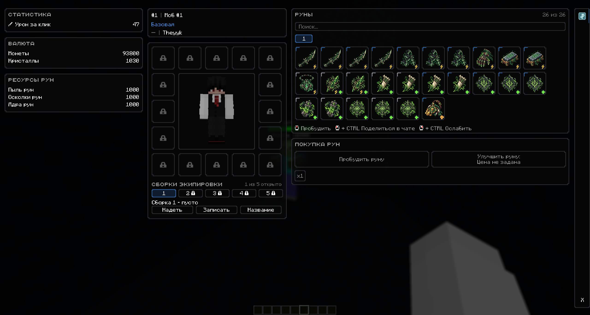
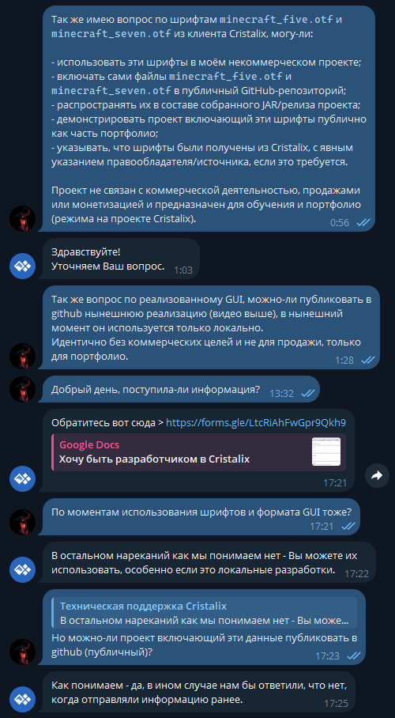

# Custom GUI Mod — Forge 1.12.2

Портфолио-проект игрового режима для Minecraft 1.12.2: интерфейс игрока, руны и статусы, собственные мобы, ресурсы и хранение данных в MongoDB. Клиент и выделенный сервер используют единый мод; текстуры рун поставляются отдельным набором ресурсов.

**Текущая версия: `v1.2.5`**

[Скачать и посмотреть историю изменений](https://github.com/Theyyk/re-volution-mod/releases) · [Документация на русском](docs/README.md) · [Русские описания версий](docs/releases/README.md)

## Возможности

- Адаптивный интерфейс со статистикой, ресурсами, персонажем, рунами и навигацией.
- Первый статус **Яд**: 26 фиксированных позиций, 11 уникальных иконок, индивидуальные ранги и поиск по названию и типу.
- Единая прогрессия рун по рангам **Обычная → Улучшенная → Продвинутая** с серверной проверкой пробуждения, сохранением уже более высоких рангов и блокировкой перехода, пока коллекция не готова к следующему этапу.
- Покупка рун `x1`, `x5`, `x10`, `x100` с серверной проверкой баланса, настраиваемым ресурсом оплаты и ценой; GUI получает фактическую цену с сервера.
- Дубликаты рун статуса **Яд** компенсируются Пылью рун: по умолчанию `+10` за дубликат; расчёт вынесен в настраиваемую конфигурацию с поддержкой базовой формулы и ивент-модификаторов.
- Подготовлены отдельные правила экономики пробуждений и улучшений (`FIXED`, `BY_RANK`, `FORMULA`, ресурс и event-множители); фактическое списание за пробуждение пока не включено.
- GUI рун предзагружает коллекцию, выбранную вкладку и статистику игрока до открытия; промежуточные состояния покупки не показываются.
- Постоянное отображение монет, кристаллов и урона вне основного интерфейса.
- Отдельные ресурсы улучшения рун: пыль, осколки и ядра, с хранением в MongoDB и управлением через Admin / Test Panel.
- Каркас 16 слотов снаряжения и пяти сборок экипировки; игровые механики снаряжения пока не реализованы.
- Собственные зомби и скелеты: награды, полоски здоровья, точки появления и быстрое возрождение.
- Команды управления мобами, ресурсами и наборами с автодополнением.
- Хранение данных игроков в MongoDB с настраиваемыми URI подключения и именем базы.
- Предзагрузка текстур рун и GUI-шрифтов, а также регрессионные проверки инвентаря, раскладки, прогрессии и экономики рун.

Интерфейс открывается клавишей `C`. [Подробнее об игровых системах](docs/gameplay.md) · [Команды](docs/commands.md).

## Скриншот интерфейса

Полный вид интерфейса: статистика, валюта, ресурсы рун, персонаж, руны и блок покупки.

## Установка и запуск

1. Установите Java 8 и Minecraft Forge **1.12.2 / 14.23.5.2859**.
2. Скачайте `customguimod-1.2.5.jar` из [релиза v1.2.5](https://github.com/Theyyk/re-volution-mod/releases/tag/v1.2.5).
3. Поместите JAR в папки `mods` клиента и сервера. Обе стороны должны использовать одинаковую версию мода; удалите старый JAR этого мода перед заменой.
4. Подготовьте MongoDB и настройте подключение для сервера.
5. Установите и включите набор ресурсов на клиенте, запустите сервер и подключитесь к нему.

[Требования, настройка MongoDB, запуск и сборка](docs/setup.md).

## Набор ресурсов

Текстуры рун находятся в [RE:volution Resource Pack v1.1.0](https://github.com/Theyyk/re-volution-resource-pack/releases/tag/v1.1.0). Выберите один вариант:

- `re-volution-resource-pack-v1.1.0-64x64.zip`;
- `re-volution-resource-pack-v1.1.0-128x128.zip`.

Поместите ZIP в папку `resourcepacks` клиента и включите его в настройках Minecraft. Мод отвечает за геометрию, состояние и поведение интерфейса, набор ресурсов — за изображения рун. Пути ресурсов используют пространство имён `customguimod`.

## Документация

[Оглавление](docs/README.md) содержит инструкции по настройке, команды, описание архитектуры, проверок и процесса выпуска. Русские описания версий хранятся в `docs/releases/`; история изменений на английском — в [GitHub Releases](https://github.com/Theyyk/re-volution-mod/releases).

## Лицензия

См. [LICENSE](LICENSE). Права и условия использования сторонних шрифтов описаны отдельно; общая лицензия репозитория их не заменяет.

## Шрифты Cristalix

Шрифты получены из клиента Cristalix; сохраняются исходные метаданные. [Ответ поддержки, область использования и указание источника](docs/permissions/cristalix.md). Использование относится к описанному некоммерческому учебному/портфолио-проекту.

