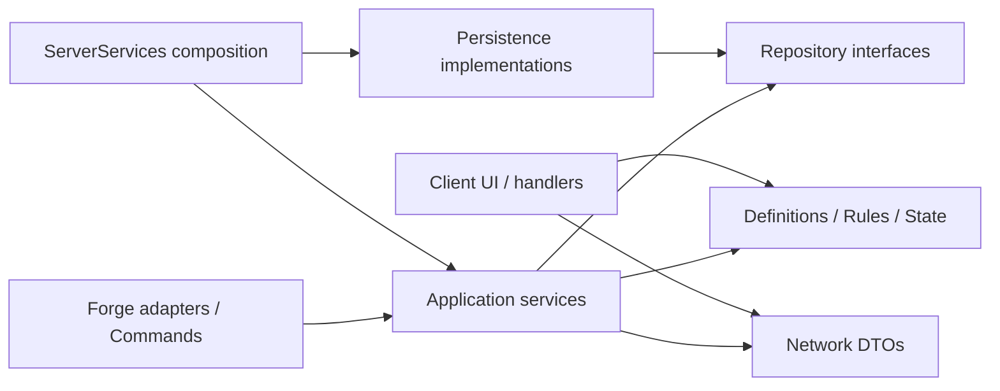

# Архитектурный контракт RE:volution Mod

Версия контракта: **1.3.1**. Цель — понятные границы ответственности при сохранении поведения 1.3.0. Forge 1.12.2, Java 8 и существующая MongoDB остаются основой проекта. Абстракции вводятся для реальных зависимостей, без контейнера DI, универсальной шины событий и пустых будущих подсистем.

## Карта пакетов

Базовый namespace: `com.example.revolution`.

| Пакет | Ответственность |
| --- | --- |
| корень | Только `RevolutionMod`: метаданные Forge, bootstrap и `@SidedProxy` |
| `lifecycle` | `CommonProxy`, `ServerLifecycle`, `ServerServices`: граф зависимостей, регистрация адаптеров, остановка |
| `config` | `BrandingProperties`: JVM-параметры и fallback старого префикса |
| `rune.definition` | Каталог, `RuneLayoutDefinition`, характеристики и составные эффекты |
| `rune.config` | `RuneEconomyConfig`, `RuneStatusConfig`: экономика и привязки статусов |
| `rune.rules` | Чистые расчёты боя, наград, рангов, пробуждения и legacy-слотов |
| `rune.state` | `RuneInventory`, `RuneCombatState`: владение рунами и временная ярость |
| `rune.repository` | `RuneEnhancementRepository`, immutable-проекция `RuneRecord`; без BSON/Minecraft |
| `rune.service` | Покупка, усиление, пробуждение, оплата, боевые эффекты, admin-операции и синхронизация |
| `mob.definition` | `MobDefinition`: сохранённая конфигурация; `ManagedMobDefinition`: разрешённый спавн с наградой |
| `mob.state` | `MobRuntimeState`: HP, entity, таймеры и флаги текущего спавна |
| `mob.rules` | `MobHealthRules`: точное HP, предел native HP и радиус эффекта |
| `mob.repository` | `MobRepository`: конфигурация и награды `custom_mobs` |
| `mob.service` | `ManagedMobService`, `MobRewardService`, `MobAdminService` |
| `mob`, `combat`, `player` | Forge-адаптеры мобов, урона и входа игрока |
| `player.repository` | `PlayerRepository`: коллекции игрока и legacy integer API баланса |
| `player.service` | Расчёт/отправка статистики, инициализация сессии и операции коллекций |
| `resource.definition` | Фиксированный каталог ресурсов и lookup/display policy |
| `resource.repository` | Ресурсы игрока и существующая очистка retired-ресурса |
| `resource.service` | Проверка достаточности, выдача и списание; без конфигурации мобов |
| `admin.definition`, `admin.repository`, `admin.service` | Whitelist DTO, порт JSON-хранилища, разрешения и операции панели |
| `persistence` | `MongoConnection`, Mongo-репозитории, `FileAdminWhitelistRepository` |
| `network`, `network.admin` | Регистрация протокола, DTO, сериализация и серверные packet-адаптеры |
| `commands` | Имена, usage, permission gate, autocomplete и делегирование сервисам |
| `client`, `client.hud`, `client.settings` | GUI, ввод, визуальное состояние, клиентские packet handlers и инициализация |
| `number` | Точные числа, форматирование и режим отображения |

## Зависимости и ООП

`ServerServices` создаёт один граф объектов на срок жизни сервера. Сервисы получают зависимости через конструкторы. Они не обращаются к `ServerLifecycle.services()`, не создают Mongo-клиенты и не ищут соседние сервисы в глобальном реестре. Доступ к текущему графу допустим только на границе Forge: у создаваемых Forge packet handlers, legacy event subscriber и permission gate команды.

`Service` выполняет операцию или координирует сценарий. `Repository` читает/пишет данные и переводит представление хранилища в значения порта. `Definition` описывает конфигурацию без entity/таймеров. `State` владеет изменяемыми runtime-значениями. `Manager` допустим для будущего владельца реестра с явным lifecycle, а не как общее имя набора статических методов. Статические функции остаются у чистых правил, конфигурации и транспортной границы Forge.

`RuneRecord` — immutable-проекция сохранённой руны; `RuneInventory` — рабочее представление владения/рангов. `MobDefinition` и `ManagedMobDefinition` не содержат живую entity: она находится в `MobRuntimeState`. BSON `Document`, Mongo-пути и JSON-файлы остаются в `persistence`. Межпакетная публичность нужна только для используемых границ.

## Lifecycle и потоки

Физические стороны разделены через `@SidedProxy`. Общая и серверная регистрация не импортируют клиентские классы. `ClientProxy` вызывает `ClientLifecycle`; клиентская регистрация пакетов находится в `ClientNetworkRegistration`. Основной runtime workflow — клиент Forge и выделенный сервер. Integrated server сохраняет прежнюю доступность команд/resource API и неактивную core player/mob persistence; нового игрового режима для него не добавлено. Runtime-проверка этого режима остаётся отдельной.

На выделенном сервере preInit создаёт граф, подключение, whitelist и Forge-адаптеры. ServerStarting регистрирует команды и выполняет прежнюю очистку retired-ресурса. ServerStarted загружает существующих managed-мобов в world 0. Остановка снимает подписки, очищает временное состояние и limiter, закрывает Mongo-клиент. Повторное создание графа не сохраняет старые подписки и мир.

Packet handlers передают операции с Netty на server thread. Ограничитель усилений работает **до постановки в очередь**. Конфигурация рун по-прежнему читается существующими функциями при обращении: новый snapshot/cache не меняет семантику JVM-параметров. Async persistence и транзакционная экономика не вводятся этим релизом.

`ManagedMobEvents` сохраняет приоритеты, фазу END server tick и отмену события до изменения entity. Сервис мобов получает world/entity/числовые аргументы вместо Forge event objects. Native HP остаётся подложкой с пределом 1024; настоящее HP хранится отдельно с `BigDecimal`.

## Операции и транспорт

`RuneActionService` маршрутизирует существующие action strings; покупку, усиление и пробуждение выполняют отдельные сервисы. `RunePacketFactory` строит metadata/display names; DTO сериализуют переданные значения. `RuneSyncService` и `PlayerStatsSyncService` отправляют результаты. `AdminPanelService` повторно проверяет whitelist на сервере.

Командные сценарии сохраняют прежние аргументы, проверки, сообщения и порядок мутаций. Длинные legacy-операции вынесены в application services, которые пока принимают sender/args как совместимый вход. Для новых CR предпочтителен типизированный метод операции; универсальная command framework не нужна.

Серверные custom-пакеты проходят через `NetworkHandler.sendToClient`, проверяющий Forge handshake. Optional-client не требует клиентского мода и не получает его пакеты. Статический `SimpleNetworkWrapper` остаётся инфраструктурой Forge, а не хранилищем бизнес-состояния.

| ID | DTO | Серверная registration side |
| --- | --- | --- |
| 0 | `PingPacket` | SERVER, через limiter |
| 1 | `PongPacket` | CLIENT |
| 2 | `RuneSlotPacket` | CLIENT |
| 3 | `RuneCollectionsPacket` | CLIENT |
| 4 | `PlayerStatsPacket` | CLIENT |
| 5 | `AdminPanelRequestPacket` | SERVER |
| 6 | `AdminPanelStatePacket` | CLIENT |
| 7 | `RuneEnhancementPacket` | CLIENT |

Клиентские registration sides также закреплены без изменения прежней схемы. Канал — `revolution:main`; modid/resource namespace — `revolution`. Неиспользуемый незарегистрированный `BalancePacket` удалён; зарегистрированный баланс ID 1 сохранён.

## Контракт совместимости

- Формулы боя, экономики, рангов, компенсации, оплаты и независимых случайных усилений 26 слотов сохранены. Боевой вклад настроенных коллекций суммируется глобально; reward bonus использует активную коллекцию.
- Action strings `buy_card`, `buy_cards:`, `load_cards`, `load_decks`, `switch_deck:`, `upgrade_rune:`, `enhance_rune:` и внешние имена команд сохраняются буквально.
- Mongo-коллекции `players`, `custom_mobs` и прежняя очистка `custom_resources` сохранены. Ключи `_id`, `balance`, `crystals`, `activeDeck`, `decks`, `cards`, `cardIndex`, `layer`, `level`, `runeEnhancements`, `resources` и конфигурация мобов не мигрируют.
- Legacy integer API баланса и канонические строки ресурсов/HP/наград сохраняют прежние типы. Репозитории не унифицируют числовую схему и не переписывают документы автоматически.
- Сохранены legacy-слоты 26–49 для чтения, ранги и fallback `money` награды моба. Whitelist сохраняет `uuid`/`name`, пути и миграцию из `customguimod`.
- Старый levels-only enhancement sync по-прежнему формирует metadata Poison. Перенос в фабрику не исправляет эту историческую особенность скрытым изменением multi-status поведения.
- Сохранены session/spawn NBT-теги, строка metadata моба, очистка persisted entity, respawn countdown, радиус яда и отсутствие vanilla drops/XP у managed-мобов.
- Набор ресурсов, пути текстур, fallback и reload не изменены. Ресурсные файлы, кроме версии в `mcmod.info`, закреплены fingerprint-контрактом.

## Фундамент будущих CR

World/Realm/Location/fixed-mob progression **не реализуются в 1.3.1**. Для следующего CR создаётся пакет по домену, а не добавляются глобальные методы в bootstrap, MongoConnection или handlers.

Новые определения Realm/Location/Position описывают постоянные параметры и стабильные ID. Runtime отдельно владеет world/entity/HP/contribution/respawn и получает определение. Сервис получает порты и необходимые соседние сервисы через конструктор, регистрируется в `ServerServices` и имеет явную остановку. Mongo-модель и миграция схемы описываются отдельно. Dimension ID, UUID entity и definition ID не подменяют друг друга.

Каждый CR фиксирует игровой сценарий, сохранение прогресса, потоки, выгрузку и runtime-проверки. Изменения wire IDs, числовых типов, optional-client, наград и resource-pack contract должны быть явными. Интерфейс вводится для используемой границы, а не для предполагаемой реализации через несколько версий.

## Автоматические проверки

`check-architecture.py` проверяет зависимости, изоляцию client/persistence, отсутствие locator в сервисах, чистоту DTO, instance-owned state, зеркальные test packages, выполнение всех regression entry points, IDs/sides 0–7, lifecycle и ресурсные fingerprints. Негативные тесты подают заведомо запрещённые зависимости.

`check-structure.py` проверяет терминологию, bootstrap-only root, package paths, branding и JAR: production-классы/ресурсы присутствуют, старые классы и тесты не упакованы. Java assertion runners исполняются из `check`; это не JUnit suite и не просто компиляция тестов.

[Проверки и runtime checklist](development.md) · [Подготовка 1.3.1](releases/v1.3.1.md) · [Первый cleanup-этап](cleanup-v1.3-plan.md).
